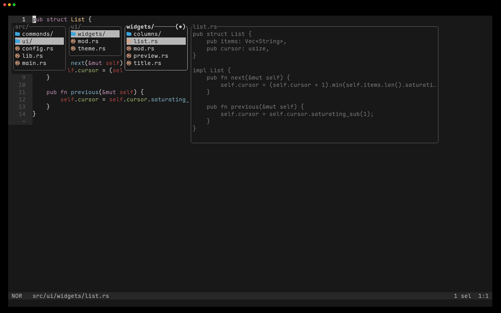

# dugtrio.hx

dugtrio.hx is a floating file explorer for [Helix](https://github.com/helix-editor/helix/), with Miller columns and a live preview. It is read-only; use Helix’s native file picker to find files by name. It is a hard fork of [forest.hx](https://github.com/Ra77a3l3-jar/forest.hx), retaining its Mini explorer.



## Installation

1. Install the plugin-enabled fork of Helix by following [these instructions](https://github.com/mattwparas/helix/blob/steel-event-system/STEEL.md).
2. Install dugtrio.hx via forge:

   ```sh
   forge pkg install --git https://github.com/howird/dugtrio.hx.git
   ```

3. Load the plugin and bind `:dugtrio-open` in `init.scm`:

   ```scheme
   (require "helix/keymaps.scm")
   (require "dugtrio/dugtrio.scm")

   ;; Optional: change the anchor, initial visibility, or blinking.
   ;; (dugtrio-configure! 'right #:show-hidden? #f #:blink-border? #t)
   ;; Use #:ignore (list "name" ...) to always exclude exact names.

   (keymap (global)
           (normal (- ":dugtrio-open")))
   ```

## Usage

The explorer is keyboard-only. Opening the explorer reveals the current file, cascading a column for each ancestor directory. `q` or `Esc` closes it. While it is open it takes every key, so `:` commands are unavailable; `dugtrio-close` is there for scripts and configuration, and does nothing if the explorer is already closed.

By default, only the active column’s selection highlight alternates between normal and dim. In `dugtrio-configure!`, use `#:blink-border? #t` to also animate the active border and title, or `#:blink-selection? #f` to keep the selection steady. Ancestor and preview panes stay steady.

| Key | Action |
|-----|--------|
| `↑` / `↓` / `j` / `k` | Move within the active column |
| `→` / `l` | Cascade into the selected directory; do nothing on files |
| `Enter` | Open the selected file or cascade into the selected directory |
| `←` / `h` | Back up to the parent column |
| `R` | Refresh the open columns and preview |
| `.` | Toggle dotfiles (`.env`, `.git`, etc.) |
| `Esc` / `q` | Close the explorer |

Dotfiles are shown by default. When a refreshed listing still contains the selected entry, Dugtrio keeps it selected. If the entry disappears, the cursor stays at the same row or moves to the last available row. A column whose directory is no longer listed in its parent (hidden, ignored or deleted) is closed, along with the columns below it.

After external changes, press `R` to refresh the listings and preview. Dugtrio lists files from the filesystem and does not consult Git.

To customize character bindings, pass a hash such as `(dugtrio-set-keybinds! (hash 'down "n"))` in `init.scm`. Unknown actions are rejected without applying any of the overrides. The action named `'enter` binds directory navigation (`l` by default); the physical Enter key still opens files.

## Demo

Run `nix run` from the checkout to launch an isolated Helix with a throwaway project. To re-record the preview, run `nix develop -c vhs .github/assets/demo.tape` from the repository root.

## Dependencies

[glyph.hx](https://github.com/Ra77a3l3-jar/glyph.hx) provides icons and is installed automatically by Forge.
